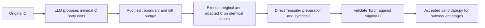

# C adaptation followed by Tenspiler

`lassi_x.c_to_torch` implements an alternative translation step:



The LLM produces C, with an explanation of its changes. The trusted pipeline
constructs the synthesis input, runs the compiler and validates the resulting
Torch. Each failed attempt remains in its own directory. Retries get feedback
within a declared proposal budget; every changed C source repeats all gates.
There is no LLM Torch translation or extended operator-composition fallback.

This is an explicit single-kernel step for campaign adapters. It does not change
the default candidate generator in `lassi-x run`, or automatically launch numerical
repair, accelerator compilation or measurement. Call `translate(plan, output)`
from a trusted adapter and use its accepted `candidate.py` as the next stage's
explicit input. The step returns false when its finite budget is exhausted.
Use the [experiment driver guide](experiment-driver-guide.md) and
[plan template](experiment-plan-template.md) before a scored campaign.

## Prompt and minimality policy

The exact prompt lives in `SYSTEM_PROMPT` in
[the implementation](../lassi_x/c_to_torch.py). Preparation exports the assembled
prompt without contacting any model. It asks for the complete translation unit
as JSON with `source` and `changes` fields. Feedback and source are structured
as data. No fixture values or expected outputs are provided to the model.

The pipeline uses Clang source ranges to enforce that only the selected function
body changes, and enforces a configurable diff budget (default 80 added/deleted
lines, both counted). The signature, initialization, main, headers and surrounding
source must retain exactly the same bytes. This excludes helper-function additions
and ABI changes in this first version. The prompt requires unchanged arithmetic
types, constants, workload and per-output accumulation order, preferring loop
splitting and canonicalization. A small diff does not prove semantic minimality;
the diff and explanation remain available for review.

The current direct preparer accepts sequences of forward/transposed matrix-vector
reductions, including supported bias inputs. It covers ATAX/BiCG/MVT structures;
it is not a general C compiler. Unsupported kernels fail explicitly. It still
uses our previously developed vector-interface adapter and constrained synthesis
driver; it does not remove that engineering or claim stock Tenspiler coverage.
It never enables the earlier `--extended` compiler/runtime.

## Independent validation gates

Every case is an explicit existing `RunConfig` YAML with an authoritative
[C fixture specification](c-fixtures.md). Cases must name the same original C
source. List each workload and alternate input fixture explicitly in `cases`;
nested correctness suites and model judges are rejected. All read-write inputs
must be declared outputs. Scratch arrays overwritten before use can be outputs
without being supplied as inputs. All observable outputs need to be declared.

For each proposal, the C gate compiles the original and adapted sources separately.
Original C initializes the inputs. Those exact typed inputs are imported into
adapted C. Both programs export all declared outputs and the final state of every
input, and must be deterministic and finite. Shapes and native types must match;
integer outputs and read-only inputs compare exactly, floating outputs use each
case's declared `arena.equivalence` tolerances. The adapter checks that both
programs received identical inputs. It rejects builds that omit `{reference}`
and execution commands without the unique `{oracle_dir}`.

Only after every C case passes does the direct preparer emit vector C++ and an
explicit integer synthesis abstraction. The abstraction changes arithmetic; it
is separate from the preserved floating-point C reimplementation. Synthesis runs
with a fixed bound, timeout and `--bounded-only`. No unbounded verification or
floating-point proof is claimed. See the
[engineering report](tenspiler-engineering-report.md) for known verifier limitations.

The pipeline assembles a Torch wrapper from synthesized stage files using the
trusted fixture argument/output mapping. It checks logical dimensions against
actual tensor shapes. Every configured case then passes through the repository's
FP64 CPU `validate_candidate` gate, using fresh fixtures from the **original C**.
Inputs, output ordering and read-only mutation checks come from that trusted
contract. A numerically wrong synthesized candidate cannot become the accepted
artifact. An accepted `candidate.py` appears at the output root only when all
cases pass. This is numerical evidence on the declared suite, not a formal
proof, independent holdout result or accelerator qualification.

## Preparing and running

A reusable ATAX example prepares MINI and SMALL cases, the fixture specification,
a plan and an explicitly hand-authored replay proposal:

```sh
uv run --locked --extra dev --extra globus --extra roofline \
  python experiments/c-to-torch-example/prepare.py \
  /absolute/path/example --native-root /absolute/path/tenspiler-native

uv run --locked --extra dev --extra globus --extra roofline \
  python -m lassi_x.c_to_torch /absolute/path/example/plan.yaml \
  /absolute/path/prompt-preview
```

The native root follows the layout documented in
[Tenspiler preparation](tenspiler-preparation.md). The example records an absolute
system Clang path for reference compilation. The separate native environment
provides LLVM 11, the pass, Racket and the solvers. Preserve the venv Python
executable path, including its symlink: resolving it to the base interpreter loses
its installed packages. Activate the native toolchain, then invoke the framework
Python by its **absolute path**, because activation changes PATH:

```sh
source /absolute/path/tenspiler-native/activate.sh
/absolute/path/LASSI-TOOLS/.venv/bin/python -m lassi_x.c_to_torch \
  /absolute/path/example/plan.yaml /absolute/path/replay \
  --execute --proposal /absolute/path/example/replay-proposal.json
```

Replay makes no model calls and tests the compiler/validation integration only.
For a live adaptation, set the plan's `model` to the intended provider/model,
endpoint, credential **source** and finite turn limits; omit `--proposal`:

```sh
/absolute/path/LASSI-TOOLS/.venv/bin/python -m lassi_x.c_to_torch \
  /absolute/path/example/plan.yaml /absolute/path/live --execute
```

The example's placeholder model deliberately requires configuration before live
use. `proposals`, `changed_lines`, `synthesis_timeout_s` and `bound` are explicit.
Model transport retries and turn timeout are controlled by `ModelConfig`; the
example allows one proposal and no transport retries. C and Torch timeouts come
from each case. Each run requires a new output directory. Relative plan paths
resolve against the plan; relative case paths follow `RunConfig` conventions.
Native environment variables are inherited, not synthesized or stored with secrets.

Artifacts include resolved plans/configs, prompt and raw response, source and
diff, adapter/template hashes, C build/run logs and binary fixtures, synthesis
commands/logs, per-case Torch gate reports, per-attempt results, and source hashes.
Validation fixtures are development data. Freeze the accepted source and use a
separate untouched holdout suite for a generalization claim.
