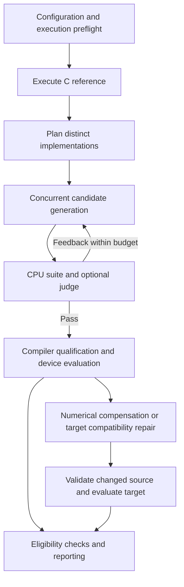

# Driving experiments in LASSI-X

This guide is for agents that need to plan, launch, monitor, recover, and report
experiments in this repository. It describes the implemented interfaces and the
remaining integration work. Read it before adapting a historical launcher.

## Start with an explicit experiment

Complete the [experiment plan template](experiment-plan-template.md) before a
sweep. Record the question, complete cohort, starting revisions, workload profiles,
precisions, targets, model budgets, validation gates, selection rules, and outputs.
Use paths and hashes for every reused implementation and reference artifact.

An implementation is an algorithmic formulation. A specialization is a revision
adapted to a particular workload, precision, or target. Track both identities;
changing either requires fresh evidence for the resulting experimental cell.

Keep three kinds of outcome distinct:

- Scientific failure: an executed candidate violates a recorded gate.
- Infrastructure or incomplete outcome: the gate could not be established.
- Unstarted or blocked case: no eligible execution occurred.

Preserve all planned cases in inventories and denominators. Report candidate pass
fraction separately from the fraction of kernels with at least one passing candidate.
A successful retry must not erase the original failed or interrupted attempt.

## Choose the supported workflow

| Need | Interface | Current boundary |
| --- | --- | --- |
| Generate, validate, repair, and measure one kernel | `lassi-x run CONFIG` | Integrated streaming pipeline; backend support depends on the configured input interface |
| Generate and CPU-validate before acquiring accelerators | `lassi-x run CONFIG --until cpu-verified` | Retains the full configuration for a later resume |
| Compare targets or policies from the same CPU cohort | `--from-cpu-baseline BASELINE` | Frozen candidates by default; adaptations require an explicit flag |
| Declare a new campaign with fixed task dependencies and attempts | `lassi-x campaign` | Runner implemented; trusted scientific adapters must implement its gates; tasks execute sequentially |
| Validate one saved implementation locally | `lassi-x validate candidate` | Correctness check, not accelerator qualification or a performance result |
| Measure one saved implementation | `lassi-x benchmark run` | Does not automatically supply an independent final holdout |
| Change explicit workload dimensions in a fixed-profile source | `lassi_x.dataset_specialization` | Size-only utility; no automatic specialization fan-out in the main pipeline |
| Reproduce an old published campaign | Its recorded launcher and protocol | Historical scripts have campaign-specific artifact layouts and recovery rules |

New campaigns should use the [frozen campaign protocol](campaigns.md). Do not wrap
a launcher that searches for the latest result and assume the wrapper makes its
selection reproducible. Write a small adapter with declared inputs and outputs.
The campaign runner manages handoffs; it does not implement scientific gates for
you, schedule multiple hosts, or sandbox candidate code.

## Establish the environment

Run from the repository root. Use the committed dependency lockfile and matching
framework revisions on the harness and execution workers. Package version `0.1.0`
alone is insufficient to identify different checkouts.

```sh
uv sync --locked --extra dev --extra globus --extra roofline
uv run --locked --extra dev --extra globus --extra roofline lassi-x skills install
uv run --locked --extra dev --extra globus --extra roofline lassi-x skills doctor
```

The remaining examples assume `lassi-x` resolves to this installed environment.
Activate its virtual environment or use the same `uv run` prefix.

Record the Git commit, whether the working tree is dirty, the relevant patch when
it is dirty, lockfile hash, interpreter versions, compiler flags, runtime versions,
and device identity. Do not upgrade pinned dependencies during a scored campaign;
that is an environment change requiring a separate recorded evaluation.

Use [experiments/run.yaml](../experiments/run.yaml) as a configuration reference,
not a ready-to-launch protocol. Its example model identifiers, queue paths,
backends, and acceptance requirements need to match the intended environment.
Check that:

- `project.root` resolves relative to the configuration file; reference and fixture
  paths resolve from that project root.
- Oracle flags select the intended dataset and declared C type. A case called
  `large` does not itself enable `-DLARGE_DATASET`.
- Candidate model count equals `arena.candidates`.
- Backend resources, supported precisions, and compiler targets are explicit.
- A distinct device evaluation dataset has its matching `measure.evaluation_oracle`.
- Required backends and precisions describe the intended success claim. An empty
  requirement list is exploratory and must not be reported as accelerator coverage.
- Tolerances, arithmetic policy, sample counts, timeouts, and all correction/retry
  budgets are finite and fixed before examining scored outcomes.

Probe the configured model endpoints and execution environment before a long run:

```sh
lassi-x models doctor --config /absolute/path/run.yaml
lassi-x execution doctor --config /absolute/path/run.yaml
```

These commands contact services or execute capability probes. The model doctor
checks tool-call replay and reported model identity; a plain successful completion
is weaker evidence. A successful execution doctor is a preflight, not a kernel
compilation, accuracy, precision, or latency certificate. CPU preparation can run
without starting remote resources; perform accelerator preflight before continuation.

## Make reference inputs authoritative

Expected results must come from executing the original C/C++ computation. Do not
translate its initializer expressions into Python, use a candidate as its own
oracle, or substitute outputs from a different workload profile.

There are two input paths today:

| Path | How acceptance inputs are obtained | What an agent must establish |
| --- | --- | --- |
| Explicit C fixture specification | Compiled C initializes and exports typed inputs; the harness supplies exact named `forward(...)` arguments | Correct field/argument mapping, access rights, scalar parameters, output order, and profile flags |
| Historical candidate builder plus trusted contract | Candidate `build_inputs(...)` supplies values, checked against a harness-owned input contract when enabled | Input parity must be enabled and bound to the actual workload; output agreement alone is insufficient |

For the C fixture path, follow [C fixtures](c-fixtures.md). It preserves native
shapes and storage types, including integer inputs, applies one target floating
dtype conversion, checks fixture hashes, and gives each correctness invocation
fresh copies. Alternate inputs must be imported into C as well as supplied to the
candidate. Preserve domain requirements such as positive-definite matrices and
consistent iterative state.

**Integration limit:** C fixture specifications are integrated into correctness
validation and direct candidate execution. Existing accelerator compiler,
precision-audit, and measurement workers still use the historical builder
interface. Measurement explicitly rejects `oracle.fixture_spec`. Do not remove
that setting merely to get past the guard and claim the same protocol was used.
Complete and validate an adapter migration, or record a separate supported input
protocol with independently verified parity.

A correctness suite can include multiple workloads and alternate valid inputs.
Every repaired revision reruns the suite. Fixture-spec cases can omit a separate
`input_contract`; historical additional cases require one. See
[correctness suites](correctness-suites.md) and [input validation](input-validation.md).

## Understand the single-kernel pipeline



Candidates stream independently. One candidate can be generating while another
is being measured or repaired. Optional GPU screening can evaluate and promote
portable numerical repairs before building downstream accelerator targets.
Compiler-only qualification never creates a latency observation.

Numerical compensation addresses precision-dependent error. Compatibility repair
addresses a target's compilation or execution failure. Keep their parent sources,
feedback, model usage, and outcomes distinct. A target-specific compatibility leaf
does not automatically become the portable implementation for other targets.

## Bound concurrency and specialization

```yaml
scheduler:
  max_candidate_flows: 3
  max_model_sessions: 4
  default_resource_concurrency: 1
```

These are example limits, not a request to launch three candidates on every host.
Candidate flows include their downstream work. Model slots cover sessions, while
resource slots cover work sharing a named compute resource. Precision compensation
and compatibility branches can overlap when their prerequisites and capacity permit.

Different size/shape specializations are not automatically generated as a Cartesian
product by `lassi-x run`. Declare those branches explicitly. Each needs its own
source revision, workspace, input/oracle identity, evidence, and budget. The size-only
specialization utility does not establish correctness, change arbitrary arithmetic
coefficients, or replace validation on the specialized workload.

The frozen campaign runner is sequential even when its plan has independent tasks.
Do not describe a campaign DAG as a parallel executor. Independent drivers also do
not share the single-run scheduler's resource semaphores. Use the site's established
lease or scheduler to serialize a shared physical accelerator across runs. Raising
concurrency for aliases of the same device does not create independent capacity.

## Launch, pause at CPU validation, and compare branches

Run one configured kernel:

```sh
lassi-x run /absolute/path/run.yaml
```

The CLI emits the actual run directory. Record it explicitly; do not rediscover it
by choosing the newest directory. To complete the CPU phase first:

```sh
lassi-x run /absolute/path/run.yaml --until cpu-verified
lassi-x run /absolute/path/run.yaml --resume /absolute/path/to/the-created-run
```

Keep the original configuration unchanged for resume. Declare intended accelerator
backends before CPU preparation. The CPU stopping point skips accelerator preflight,
qualification, measurement, compensation, and compatibility repair. A `cpu_verified`
run means at least one candidate passed its CPU gate; inspect the individual outcomes.

For independent comparisons from the same accepted CPU cohort:

```sh
lassi-x run /absolute/path/target-a.yaml --from-cpu-baseline /absolute/path/cpu-run
lassi-x run /absolute/path/target-b.yaml --from-cpu-baseline /absolute/path/cpu-run
```

Baseline import verifies copied artifacts and preserves candidate origin metadata.
Candidates are frozen by default. Add `--allow-adaptations` only when adaptations
belong to the recorded comparison. The kernel, reference/context/fixture identities,
oracle configuration, and CPU tolerances must match the baseline contract.
A baseline import creates a new run; it cannot be combined with `--resume` or `--until`.

## Drive a frozen campaign

Prepare a plan that declares every adapter, reference, configuration, candidate,
feedback artifact, gate, dependency outcome, and attempt budget. Use the full example
and stage adapter contract in [campaigns.md](campaigns.md).

```sh
lassi-x campaign prepare /absolute/path/plan.yaml /absolute/path/new-campaign
lassi-x campaign status /absolute/path/new-campaign
lassi-x campaign run /absolute/path/new-campaign
```

Preparation snapshots inputs and validates the graph without model calls or task
execution. It refuses an existing destination. Execution happens through `run` and
`retry`. Installed commands and packages are not automatically frozen by preparing
a plan: record and reproduce their environment separately.

Adapters read `LASSI_CAMPAIGN_CONTEXT`, resolve declared inputs through
`StageContext.input_path()`, and produce declared artifacts in `work_dir`. Their
verdict must report every planned check exactly once. The trusted adapter writes
the verdict; the candidate must not decide its own acceptance.

An adapter exits zero when it successfully reports an outcome, including a scientific
failure. Nonzero exit, timeout, malformed/missing verdict, changed input, or missing
passing output yields an incomplete attempt. Use explicit `[failed]` dependencies
for repairs, and explicit campaign/task/attempt/output identities when importing
rejected sources or feedback. A passed generation stage is not inherited validation.

## Monitor and recover without duplicating work

Inspect bounded log excerpts and the recorded artifacts rather than printing full
compiler graphs, tensors, arrays, or recursive directory listings. Redirect complete
logs to files and report the path, status, counts, and relevant excerpts. Start with:

| Artifact | What it answers |
| --- | --- |
| `resolved-config.yaml` | Which policy and workloads were requested? |
| `checkpoint.json` | Which global stages completed? |
| `progress/cN.json` | Which candidate stages and measurement cells were recorded? |
| `diagnostics/` and `suite.json` | Which exact gate or workload failed, and why? |
| `measurements.jsonl` | Which observations exist, including failures? |
| `run.json`, `summary.md`, `frontier.json` | What was accepted, reported, or selected? |
| Campaign `result.json` and `result.sha256` | What happened in one numbered task attempt? |

| Situation | Recovery |
| --- | --- |
| Interrupted single-kernel run | Resume its exact directory with the same configuration; journals restore completed work |
| Crashed compatibility repair needing a new attempt | Use `--resume RUN --retry-interrupted-repairs`; existing evidence and source history are retained |
| Saved numerical edits requiring the supported screening recovery path | Use `--resume RUN --retry-numerical-repairs`; this is a specific recovery feature, not a generic sweep restart |
| Failed/incomplete frozen-campaign task | Inspect the reason, then `campaign retry DIR --task ID` within its budget; use `campaign run DIR` afterward |
| Already-passed campaign task, changed protocol, or ancestor with executed descendants | Prepare a new plan with explicit imports |
| Lost acknowledgement, live remote PID/job, or ambiguous submission | Reconcile the recorded remote work before resubmitting; a missing reply does not prove the command never ran |
| Source, fixture, plan, result, or oracle hash mismatch | Preserve the evidence and investigate; do not patch the stored hash to force continuation |

Do not launch a second driver over the same run or active campaign. For remote
work, retain request IDs, job IDs, resource names, and known process ownership.
Hard termination can leave external scheduler jobs alive even when local cleanup
normally kills process groups. Resource heartbeats indicate responsiveness; they
do not certify a completed measurement or its correctness.

Hermes workers use separate temporary profiles, and each run uses a temporary home
by default. Explicit home overrides should be unique per run. Avoid manual edits to
shared Hermes registrations while a driver is active. Teardown and protocol failures
are infrastructure evidence, not reasons to spend more candidate correction turns.

## Accept results using the right gates

Record these decisions independently:

1. CPU semantic validation against the C reference, with the complete development
   suite and optional configured judge.
2. Input semantics for the actual workload and revision.
3. Target execution and numerical accuracy on the measured workload.
4. Precision-policy evidence bound to that source, precision, profile, and target.
5. Comparable latency with the required timing protocol and device identity.
6. Independent final holdout qualification, when the experiment claims it.

`status: ok` is not a blanket correctness certificate. The current accelerator
accuracy defaults distinguish concerning relative L2 error at 0.01 and catastrophic
error at 0.1. Frontier eligibility and run acceptance do not mean every error is
below 1%. `stable_success` applies an additional relative-L2-at-most-0.01 condition.
Use the actual configured policy in reports; do not substitute these defaults for
an experiment's stricter requirements. See [precision integrity](precision-integrity.md).

Architectural accelerator timing requires device-resident inputs and ready outputs,
a device timing source, warmup, and single-invocation samples. Compilation, transfers,
allocation, executable loading, attachment, and queue time are excluded. Report
transfer-inclusive or host timings separately with their actual scope. CPU diagnosis
cannot establish accelerator performance or a target precision certificate.

## Keep final holdouts independent

Freeze selected sources before final holdout evaluation. Preserve their exact input
and oracle contracts, policy, source hashes, and environment. Keep holdout feedback
out of generation and scored repairs. Any tuning informed by those results makes
them development data and requires a new untouched final evaluation.

[Accuracy holdout](accuracy-holdout.md) documents one existing campaign's machinery
and results. Its preparation and launcher expect that campaign's artifact layout;
they are not a universal importer for arbitrary run or campaign directories. Build
an explicit adapter for a new layout and retain the canonical control, all cases,
and incomplete outcomes. Do not infer generalization from a single default initializer.

## Report and hand off

Deliver the completed plan with explicit artifact locations, the full planned and
executed counts, candidate-level and kernel-level outcomes, attempt history, model
usage, revision lineage, workload/precision/device coverage, and excluded or
incomplete cases with reasons. State which results are CPU-only, target-validated,
precision-verified, performance-eligible, and independently held out.

For the next agent, record the exact continuation command, remaining budgets,
active remote work and resource ownership, the next unresolved gate, and any
implementation limits. Never hand off only a plot or a list of successful kernels.

Framework changes require the [full development checks](development.md). Passing
local tests does not establish live accelerator behavior or green GitHub Actions;
if changes are pushed, verify CI for the exact pushed commit. Preserve unrelated
historical artifacts and review the staged file list before committing.
