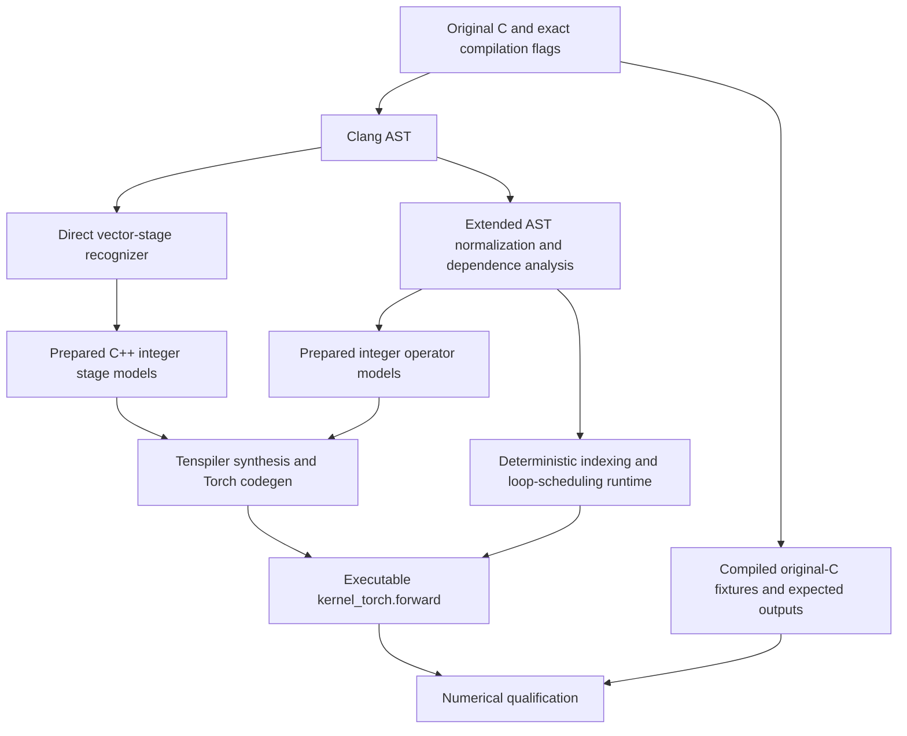

# Making Tenspiler work with the PolyBench kernels

This document explains the changes needed to run Tenspiler on this Apple Silicon
machine and produce executable PyTorch candidates for the repository's PolyBench
cohort. It covers the native installation, source preparation, generated drivers,
execution support, verification corrections, and numerical validation.

The final result is **30/30 PolyBench LARGE kernels passing three C-reference cases
each: 90/90 cases**. Achieving that coverage required more than installing Tenspiler
or changing C declarations. Three kernels use direct stage synthesis; the other
27 use Tenspiler-generated operators connected by a new deterministic compiler
and runtime. The result is a numerically qualified development baseline, with
different proof boundaries for those two paths.

For commands and interface details, see [the preparation guide](tenspiler-preparation.md).
Exact outcomes, hashes, and the complete cohort are preserved in the local,
uncommitted experiment archive at
`docs/experiments/tenspiler-expanded-20261104/RESULTS.md` and `catalog.json`.
The separate [minimal C adaptation workflow](c-to-torch.md) excludes the extended
operator-composition runtime described in this report.

## 1. What initially failed

The first unmodified-source experiment attempted every PolyBench kernel on MINI,
SMALL, and MEDIUM: 90 attempts. Original C compilation to LLVM 11 and the loop
passes succeeded in every attempt, but none reached synthesis or emitted Torch.

The failures exposed several independent interface and frontend limitations:

| Original program feature | Observed limitation | Required response |
| --- | --- | --- |
| A `void` function mutates output arrays | The LLVM frontend tried to read a return operand from `ret void` | Return computed vectors explicitly |
| C array and pointer parameters | The supported frontend path expected modeled vector containers | Convert supported computations to C++ vector interfaces |
| `double` and `float` computations | The installed analysis rejected the relevant floating scalar/vector types | Separate floating reference code from an explicit integer synthesis model |
| Multiple computation loops | The automatic extractor rejected more than two total `for` statements in 28 kernels | Decompose computations and provide our own drivers |
| General recurrences and in-place updates | The original matrix–vector preparation rules could not describe their dependencies | Add normalized AST orchestration and dependence-aware schedules |

These failures were reproducible before the solver ran. Longer solver timeouts
and larger symbolic bounds could not resolve them. They also were not evidence
that Apple Silicon could not execute the tool: a supported upstream C++ input
already reached native synthesis and generated executable Torch.

The local original-source archive at
`docs/experiments/tenspiler-polybench-20261104/RESULTS.md` preserves the individual failures. Its historical solver-success wording must be
read with the later verification audit in section 7.

## 2. Making the native toolchain run on Apple Silicon

The tested installation uses the pinned Tenspiler revision
`9705480954ec7b67bb7f1d29bc5566515635df30`. Its native environment is separate
from LASSI's locked Python 3.12 environment:

| Component | Tested version | Role |
| --- | --- | --- |
| Python | 3.9.6 | Tenspiler and its pinned Python dependencies |
| PyTorch | 2.1.2 | Execute generated Torch |
| llvmlite | 0.39.1 | LLVM analysis bindings |
| Clang/LLVM | 11.1.0 | Emit the LLVM dialect expected by this frontend and build/use its pass |
| Racket | 8.7 | Run Rosette synthesis |
| Bitwuzla | 0.9.1 | Solver used by the native synthesis route |
| CVC5 | 1.4.2 | Run generated verification queries |

Native dependencies and the custom `AddEmptyBlocks` LLVM pass were installed or
built for this environment. The model compilation pipeline emits LLVM with
Clang 11, then applies `addEmptyBlock`, `lowerinvoke`, unreachable-block elimination,
and instruction naming before extracting loop information. The current system
Clang compiles the independent original-C reference executables.

The model compile uses `-O0` and `-fno-discard-value-names` to retain the loop
structure and names needed by analysis, together with `-stdlib=libc++`,
`-ffp-contract=off`, and the selected SDK. Original-C qualification uses system
Clang with `-O3 -ffp-contract=off` and the exact dataset macro. Keeping contraction
disabled avoids introducing fused multiply-add differences through those compiler
commands, although generated tensor reductions can still have a different order.

Three small compatibility patches were applied to an isolated Tenspiler source
copy under `runs/tenspiler-native-20261103/source`:

1. **Accept both C++ template closing-angle spellings.** The frontend's vector-type
   regular expressions expected whitespace such as `> >`; LLVM could present
   `>>`. The patterns now accept optional whitespace between closing brackets.
   This fixes type recognition without adding floating-point modeling support.
2. **Replace the original developer's absolute Bitwuzla path.** The Rosette
   configuration pointed to a binary on the upstream developer's machine. It
   now points to the installed native binary. Initial Z3 attempts timed out;
   the successful native workflow used Bitwuzla.
3. **Raise CVC5's internal limit from 1 ms to 10,000 ms.** The original
   `--tlimit=1` was too short even for the smoke experiment. This is separate
   from the outer per-stage timeout and does not resolve unsupported source code
   or establish that a verification result is sound.

Runtime library isolation was also necessary. Exposing the entire old LLVM library
directory through `DYLD_LIBRARY_PATH` caused C++ runtime compatibility problems
with other native tools. The activation script instead exposes a small
`runtime-libs` directory for the required GMP/MPFR libraries, and sets the SDK,
deployment target, executable paths, and an isolated Racket user directory.

The exact patch and environment are recorded in
`runs/tenspiler-native-20261103/native-compatibility.patch`, `activate.sh`, and
`setup-status.json`. These are local installation artifacts; the pinned
`third_party/tenspiler` submodule was left unchanged. The tested result shows that
native arm64 execution is possible. The remaining source/model restrictions belong
to this Tenspiler workflow rather than to a blanket lack of ARM support.

## 3. The first usable source transformation: explicit vector stages

The first successful preparation path targets matrix–vector reductions. The
following illustrates the interface change; it is not a literal replacement for
every C function:

```c
/* Original style: output is an array side effect. */
void kernel(int m, int n, double A[m][n], double x[n], double y[m]) {
    for (int i = 0; i < m; i++) {
        y[i] = 0;
        for (int j = 0; j < n; j++)
            y[i] += A[i][j] * x[j];
    }
}
```

```cpp
// Prepared reference style: explicit vector inputs and return value.
vector<double> stage(vector<vector<double>> weight, vector<double> input) {
    vector<double> output;
    for (int row = 0; row < weight.size(); row++) {
        double curr = 0;
        for (int col = 0; col < input.size(); col++)
            curr = curr + weight[row][col] * input[col];
        output.push_back(curr);
    }
    return output;
}
```

This transformation makes outputs visible to Tenspiler and places arrays in its
supported container representation. The original-type C++ reference retains the
scalar computation and reduction order. Its wrapper checks positive logical
dimensions and rectangular shapes. The adapted interface assumes disjoint arrays.

The complete computation may need more than one stage:

- **ATAX:** compute the temporary vector, then consume it in a transposed
  matrix–vector reduction. The producer must finish before the consumer runs.
- **BiCG:** distribute the independent output reductions into separate stages.
- **MVT:** retain each original output vector as an initial accumulator input,
  rather than replacing it with zero.

For MVT, the prepared loop begins with `curr = bias[row]`. The generated summary
therefore includes the original accumulator plus the matrix–vector result. Omitting
that input would produce a different algorithm even if the code compiled.

The preparer recognizes these operations from Clang's AST. It checks initialization,
indices, bounds, update expressions, and stage dependencies; it does not dispatch
on `atax`, `bicg`, or another filename. Output order follows the manifest's original
parameter mapping, which can differ from stage execution order.

### Why an integer model was still needed

Changing arrays to returned vectors did not make the installed frontend accept
floating vector analysis. Preparation therefore emits two distinct representations:

- Original-type reference stages, such as `vector<double>` with `double` arithmetic.
- Explicitly requested integer-model stages for Tenspiler synthesis.

`--integer-model` authorizes that abstraction. Replacing `double` with `int` changes
arithmetic semantics; it is not a semantics-preserving mechanical C rewrite.
Running the generated raw Torch functions on floating tensors then requires a
separate comparison with the original C. The orchestration avoids upstream
convenience wrappers that force FP32, so supplied FP64 tensors retain their dtype.

### Why custom synthesis drivers were needed

The generic automatic grammar route was insufficient. A pilot also encountered an
undeclared-function error in generated SMT. We supplied fixed stage drivers with
postcondition grammars and loop invariants for forward and transposed reductions.
They relate the running accumulator to a product-sum prefix and completed output
rows to a matrix–vector prefix. Transposed cases require different row/column
bounds and column-prefix relationships; rectangular test cases expose mistakes
that square matrices can hide.

These are deliberately constrained searches. For example, the direct stage
postcondition chooses between forward and transposed matrix–vector expressions.
The drivers do not ask Tenspiler to discover an arbitrary tensor algorithm from
unrestricted C. Their final proof status is discussed in section 7.

## 4. Extending beyond matrix–vector kernels

Direct vector stages covered only a small part of the cohort. The other kernels
needed scalar coefficients, matrix outputs, local state, branches, triangular
bounds, time steps, and recurrences. To support them, we added an explicit
`--extended` path that compiles a normalized AST into deterministic orchestration
around Tenspiler-generated operators.



The normalized representation preserves parameters, typed literals and casts,
array accesses, expressions, assignments, blocks, local declarations, conditionals,
and supported increasing/decreasing loops. It also handles chained assignments
in their source assignment order. Fractional constants remain fractional; treating
them as integers would silently change stencil coefficients and similar formulas.

Tenspiler receives small models for addition, subtraction, multiplication, division,
selection, sum, maximum, square root, exponential, and matrix–vector multiplication.
The primitive postcondition searches are also narrow: the scalar driver, for
example, chooses between the modeled expression and that expression plus one.
The goal is reusable generated operators, not a broad algorithm search.

The new runtime supplies indexing, broadcasting, loop scheduling, comparisons,
control flow, shape handling, and output assembly. It tracks named iteration axes
so values varying over different loop indices align correctly. Mutated array
parameters are cloned, and all mutated arrays are returned through the manifest
interface. Supported reductions use generated operators; separable product sums
can be batched through the generated matrix–vector function without materializing
an entire cubic product tensor.

**This was the largest change in scope.** Tenspiler generates operators, while our
compiler/runtime supplies much of the complete kernel's structure. Consequently,
the 27 composed kernels are a hybrid baseline. Their coverage must be reported
separately from whole-kernel Tenspiler translation.

## 5. Preserving dependencies and making recurrences executable

Vectorizing every loop would make several kernels incorrect. We added structural
checks and scheduling rules to preserve the dependencies present in the parsed C.

| Change | Why it was needed | Examples in this cohort |
| --- | --- | --- |
| Affine access/dependence analysis | Parallel iterations must not overwrite another iteration's required values | Matrix kernels and stencil maps |
| Conservative local-state checks | A temporary can vary independently only when reset before its per-iteration use | Solvers with local accumulators |
| Fixed-pivot disjointness checks | Updating future columns can be independent of reading a fixed pivot column | Gram–Schmidt |
| Dynamic reduction alias checks | A reduction may read a disjoint prefix of an array it also updates | Triangular solver computations |
| Sequential fallback | Some remaining recurrences genuinely require source iteration order | Recurrence portions of ADI, Deriche, and solvers |
| Guarded min-plus pivot schedule | An in-place pivot update needs a condition before evaluating a whole pivot in parallel | Floyd–Warshall |
| Weighted spatial wavefront | An in-place stencil uses newly written preceding cells and old future cells | Seidel-2D |
| Increasing-span interval schedule | A table entry depends on already computed shorter intervals | Nussinov |

Affine checks use exact rational coefficients rather than floating arithmetic.
They compare accesses from different iterations and reject parallelization when
independence cannot be established under the implemented rules. Unsupported
dependent bounds remain sequential or produce an explicit unsupported outcome.

For Floyd–Warshall, the recognized update has the form
`D[i][j] = min(D[i][j], D[i][k] + D[k][j])`. The runtime vectorizes a pivot only
when its diagonal is nonnegative. Otherwise it executes the original loop order.
That guard matters because a negative pivot can change values later reads observe.

For Seidel-2D, ordinary simultaneous stencil evaluation would change the algorithm.
The new schedule groups cells by a weighted level `w*i + j`, where `w` exceeds
the horizontal stencil radius. This orders the recognized predecessor/future
accesses consistently with the original sweep while allowing independent cells
on a level to execute together. Time steps remain ordered.

For Nussinov, increasing interval length makes shorter table intervals available
before longer ones. The implementation supports the recognized split recurrence
and its maximum reduction over uniformly sized per-level ranges. This is a
specific structural rule, not general support for arbitrary ragged loops.

Each scheduling rule is selected by source structure, not the kernel name. These
compiler rules are outside the Tenspiler operator proofs and have independent
original-C numerical evidence.

## 6. Backend and floating-point changes

### Tensor-valued conditional expressions

Upstream scalar selection code could contain a Python expression such as
`a if condition else b`, with Python `not` in its condition. Once a condition is a
multi-element tensor, Python cannot interpret it as one Boolean value.

A deterministic AST postpass on the generated selection operator replaces the
conditional expression with `torch.where` and logical negation with
`torch.logical_not`. Raw generated code is retained alongside the transformed
code. This backend compatibility pass is outside the integer-model proof and is
covered by the final numerical checks.

### Scalar mathematical functions

The extended path supports configured `sqrt` and `exp` models. Positive
constant-base `pow(base, exponent)` is normalized to
`exp(log(base) * exponent)`. This lets the existing operator set express formulas
such as those in Deriche, but the normalization can change floating rounding.
Unsupported external functions are rejected. Upstream integer square-root and
exponential abstractions do not establish floating-point function equivalence.

### Ordered reductions for sensitive kernels

The ordinary composed path can reassociate additions or distribute a sum across
an expression. That is useful for tensor execution, but floating-point addition
is order dependent. For example, adding `1e16`, `1`, and `-1e16` in different
groupings can produce different results in double precision.

Gram–Schmidt exposed this sensitivity during MINI development. Durbin later failed
the LARGE numerical gate with ordinary reductions, with relative L2 errors around
`3e-9` to `6e-9` in two recorded cases, above the `1e-10` double threshold.

We added `--ordered-reductions`. It evaluates eligible reduction terms and then
accumulates them in scalar source order using the generated arithmetic operators.
The final policy enables it for Gram–Schmidt and Durbin. Durbin subsequently passed
all three LARGE cases. The thresholds were retained; the source-order option is
explicit rather than a hidden per-kernel rewrite.

One alternate MINI Gram–Schmidt case produced nonfinite output in the original C
itself. It remains a reference failure in the history. Its two finite MINI cases
matched C exactly with ordered reductions; all three final LARGE cases passed.

## 7. Correcting verification assumptions and separating proof status

Two upstream verification defects were discovered while expanding the preparer.
They are material: an inconsistent assumption set can make an incorrect candidate
appear proved because every proposition follows from a contradiction.

### Empty-prefix axioms

Some upstream elementwise and matrix–vector prefix axioms allowed prefix index
zero while constructing a nonempty result on the other side of the equality.
For example, their effect at zero could equate an empty list with a singleton.
That cannot be a valid list identity.

The local stage driver replaces those axioms with guarded nonempty-prefix
identities and adds explicit rectangular-shape preconditions. Guarded prefix-update,
commutativity, rectangularity, and transpose lemmas connect the actual loop
updates with their summaries. The maximum-reduction driver also uses a local
prefix lemma guarded to avoid an invalid empty prefix.

### Transpose with no empty-column base case

The SMT prelude stopped transpose recursion for an empty matrix but not for a
nonempty matrix containing empty rows. For `[[]]`, the definition effectively
requires its transpose to equal a list element prepended to itself, which is
impossible for a finite list.

The generated driver patches the known prelude text in memory to stop when the
first row has zero columns too. An unrecognized prelude layout raises an error.
This correction does not edit the upstream submodule or silently patch stored
historical evidence.

### Controls and remaining limitations

The audit ran a query containing the original list prelude with no candidate
correctness assertion. CVC5 returned `UNSAT`, demonstrating inconsistency in that
prelude. A concrete empty-prefix control also returned `UNSAT` with the invalid
guard and `SAT` after the guard correction. The full corrected-prelude consistency
query timed out; it did **not** prove consistency.

Forward matrix–vector and primitive operator queries can report `UNSAT` under the
corrected local assumptions. Transposed and biased direct-stage proofs remained
unresolved within the recorded budget. The final campaign therefore records:

| Final route | Kernels | Verification policy |
| --- | ---: | --- |
| Direct stages: ATAX, BiCG, MVT | 3 | Explicit `--bounded-only`; no unbounded verification claim |
| Composed operators | 27 | Request operator verification; retain solver-reported results under corrected local lemmas |

Bounded-only generation is an explicit option, not a failed proof relabeled as a
success. It emits candidates that still require numerical qualification. Neither
route establishes a whole-program floating-point theorem. Earlier historical
`UNSAT` records made with the defective assumptions must not be cited as trustworthy
formal proofs, even where independent numerical comparisons remain valid.

Control files and solver outputs are retained under
`runs/tenspiler-expanded-20261104/verification-controls`.

## 8. Making runs bounded, repeatable, and attributable

Preparation and execution are separate operations. Preparation parses source and
writes models, drivers, and manifests; synthesis starts only when the emitted
driver is invoked. Repeated preparation with the same inputs and options emits
the same bytes. Existing destinations are refused, and generated-file hashes are
checked before execution.

Generated drivers record commands and logs, use finite compile/synthesis limits,
and terminate synthesis process groups on timeout. Default synthesis uses symbolic
list bound 2 and 30 seconds per stage or operator. The native solver also has its
separate internal limit.

**The symbolic list bound is different from the LARGE dataset size.** A reusable
operator can be synthesized with short symbolic lists and later executed on the
full LARGE tensors. Large dimensions chiefly increase reference execution,
generated-kernel work, memory, and numerical sensitivity in this decomposed
workflow. They do not require encoding every LARGE element into each operator's
synthesis problem. A new workload still needs its own numerical evidence.

The composed operator cache includes the model source, driver templates, native
source identity, compiler identity, symbolic bound, sysroot setting, and verification
policy in its key. A bounded-only cache entry cannot satisfy an unbounded request.

Execution also has finite resource checks: a configurable residual scalar-step
limit, four-million-step ordered-reduction and wavefront caps, and checks on
materialized intermediates at 16 million elements. The final LARGE configuration
allowed eight million residual scalar iterations. Variant workers had 900-second
limits; kernels and solver stages ran sequentially, with at most three independent
one-Torch-thread numerical variant workers per kernel. Budget exhaustion remains
an incomplete result rather than being treated as unsupported syntax.

Frozen `lassi-x campaign` plans bind explicit sources, configurations, candidates,
and evidence by path and hash. They retain the complete cohort and failed attempts.
The final campaign reused 28 numerical records only after checking identical
original source/header identities, full program manifests, and every executable
candidate file byte for byte. The changed Durbin and Gram–Schmidt candidates
received fresh three-case LARGE validation. Updated solver evidence is recorded
separately from reused numerical evidence.

## 9. Establishing correctness against the original C

Successful synthesis and import are insufficient. The validation harness compiles
and executes the original C with the exact dataset flag and initializer, exporting
typed inputs and expected outputs as binary fixtures. It does not translate the
initializer into Python or use the candidate as its own oracle.

Before the original initializer, the harness zero-defines otherwise-uninitialized
array storage so scratch, boundary, and untouched output regions have a specified
value. This is part of the recorded fixture contract. The original kernel source
remains unchanged. Alternate cases are constructed in C using the recorded array
scalings and four-symbol character rotations, with no shape reductions.

Validation checks all mutated outputs, their full shapes and boundary/scratch
regions, finite values, and input immutability. Both candidate and reference receive
the same initial values. Original storage types are retained:

| Output arithmetic | Final numerical gate |
| --- | --- |
| Double, used by 27 kernels | Relative L2 and scaled maximum absolute error each at most `1e-10` |
| Float, used by Deriche | The same two measures each at most `1e-4` |
| Integer, used by Floyd–Warshall and Nussinov | Exact equality |

Scaled maximum absolute error divides the largest absolute difference by
`max(1, max(abs(reference)))`. Nonfinite candidate or reference output cannot
qualify. The final 90-case result uses actual LARGE dimensions, not smaller inputs
named LARGE. Numerical timings collected during concurrent qualification are not
performance benchmark results.

The progression was: zero unmodified kernels reaching synthesis; an ATAX/BiCG
pilot; a deterministic two-kernel preparer; 27 MINI passes; 29 MINI passes with a
separate Gram–Schmidt reference failure; 29 LARGE passes before the Durbin fix;
then 30 LARGE passes in final qualification. The histories remain intact. These
are development results informed by earlier failures, not an independent holdout.

## 10. Where the changes live

| File or artifact | Responsibility |
| --- | --- |
| [tenspiler_prepare.py](../lassi_x/tenspiler_prepare.py) | Clang invocation, direct stage recognition, interfaces, source/dependency hashes, options, and emitted artifacts |
| [tenspiler_affine.py](../lassi_x/tenspiler_affine.py) | Extended AST normalization, dependence analysis, structural schedules, and operator models |
| [tenspiler-driver.py.txt](../lassi_x/resources/tenspiler-driver.py.txt) | Direct stage synthesis, invariants, guarded local lemmas, SMT prelude correction, timeouts, and Torch assembly |
| [tenspiler-composed-driver.py.txt](../lassi_x/resources/tenspiler-composed-driver.py.txt) | Operator generation, selection postpass, cache, proof policy, and composed entry point |
| [tenspiler-affine-runtime.py.txt](../lassi_x/resources/tenspiler-affine-runtime.py.txt) | Named-axis evaluation, indexing, reductions, schedules, cloning, and execution budgets |
| [Preparer tests](../tests/test_tenspiler_prepare.py) and [composition tests](../tests/test_tenspiler_affine.py) | Determinism, refusal behavior, interfaces, C comparisons, dependency preservation, ordered reduction, and budget regression checks |
| `runs/tenspiler-native-20261103/` | Isolated native installation, compatibility patch, versions, and smoke history |
| `runs/tenspiler-expanded-20261104/final-campaign/` | Frozen final attempts and evidence |
| `runs/tenspiler-expanded-20261104/compiler-generated-baseline.tar.gz` | Exported references, prepared models, generated Torch, drivers, proof logs, catalog, and qualification evidence |

The authoring of these rules and drivers involved this coding assistant. Once
implemented, preparation, synthesis, codegen postprocessing, and execution make no
LLM-service calls and require no per-file model rewrite. Fixed rules can be rerun
deterministically; that does not make their complete compiler/runtime behavior
formally verified.

Repository and clean-checkout validation each passed lint, formatting, strict type
checks, and 546 tests, with two availability skips. The built wheel was checked to
contain the exact new modules and all three templates. These checks complement the
native experiments; they do not establish Linux CI or accelerator correctness.

For a translation comparison, label this result as an **adapted Tenspiler baseline
with direct and composed routes**, and report preparation/scheduling support as
part of the method. The evidence supports full numerical coverage of this fixed
30-kernel PolyBench LARGE development cohort. It does not establish unmodified
Tenspiler coverage, arbitrary C support, or coverage of the Rodinia and NPB suites.
